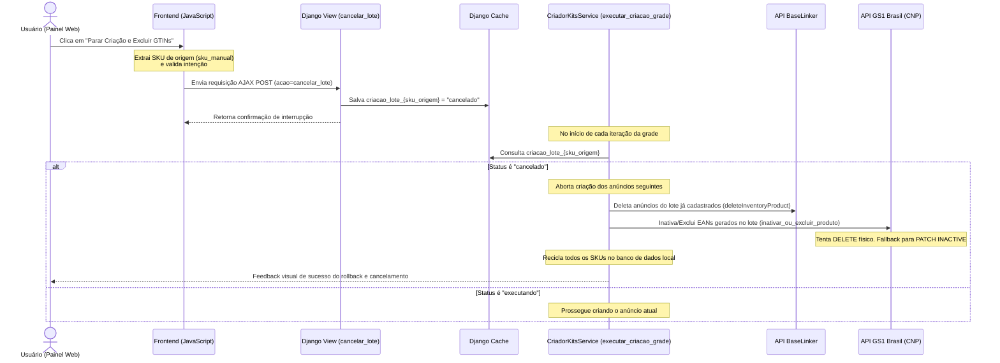

# Documentação Técnica — Módulo `criacao_estruturado`

## Visão Geral

O módulo `criacao_estruturado` é responsável pela criação automatizada de **grades de kits** no BaseLinker, com integração ao Mercado Livre. A partir de um único produto base, o sistema gera 6 variações de anúncio (1/2/3 unidades × Clássico/Premium), com títulos otimizados para SEO, descrição persuasiva, ficha técnica preenchida por IA, precificação automática via Motor R831 v2 e registro de EAN/GTIN na GS1 Brasil. Permite também a combinação de até 5 produtos no total (1 principal + até 4 secundários) para Kit Misto.

---

## Estrutura de Arquivos

```
criacao_estruturado/
├── services/
│   └── criador_kits_service.py   # Core: SEOGenerator + CriadorKitsService
├── models/
│   ├── historico_kit.py          # Registro de kits criados
│   ├── gtin_kit.py               # Cache de GTINs/EANs por kit
│   ├── ncm_gpc.py                # Mapeamento permanente NCM -> GPC
│   ├── numero_reciclado.py       # SKUs com falha para reaproveitamento
│   ├── baselinker_kit_sku.py     # Cache de SKUs no BaseLinker
│   └── controle_sequencia.py    # Sequência de SKUs (legado)
├── views.py                      # Painel web de criação de kits
└── urls.py
```

---

## Modelos

### `HistoricoKit`
Registra cada kit criado com sucesso.

| Campo | Tipo | Descrição |
|---|---|---|
| `sku_origem` | CharField(60) | SKU do produto base |
| `id_origem` | CharField(50) | PID do produto base no BaseLinker |
| `sku_kit` | CharField(60) | SKU do kit criado (único) |
| `id_kit` | CharField(50) | PID do kit no BaseLinker |
| `criado_em` | DateTimeField | Auto preenchido na criação |

### `GtinKit`
Persistência de GTINs gerados na GS1 Brasil. Mapeia e rastreia o GTIN gerado individualmente por SKU final de kit (`sku_kit`).

| Campo | Tipo | Descrição |
|---|---|---|
| `sku_origem` | CharField(60) | SKU do produto base |
| `sku_kit` | CharField(60) | SKU único do kit gerado (Indexado) |
| `quantidade` | IntegerField | Quantidade do kit (2, 3 ou 4) |
| `gtin` | CharField(20) | EAN gerado (compartilhado por Clássico/Premium no mesmo lote) |
| `criado_em` | DateTimeField | Auto preenchido |

**Regra de Unicidade:** O modelo indexa individualmente por `sku_kit` (a restrição `unique_together` de `sku_origem` e `quantidade` foi removida para permitir que lotes de grade criados em momentos diferentes gerem novos GTINs independentes para o mesmo produto base).

### `NcmGpc` [DESCONTINUADO em 23/06/2026]
Este modelo e seu mapeamento permanente e dinâmico de NCM para GPC foram removidos para evitar inconsistências e permitir inserção manual obrigatória no painel.

*(Tabela e modelo removidos fisicamente)*

### `NumeroReciclado`
Tabela de SKUs que falharam durante a criação e devem ser reaproveitados na próxima tentativa.

| Campo | Tipo | Descrição |
|---|---|---|
| `numero` | PositiveIntegerField | SKU a reciclar (único) |

### `BaselinkerKitSku`
Cache local dos SKUs de kits existentes no BaseLinker, usado para reconciliação.

| Campo | Tipo | Descrição |
|---|---|---|
| `sku` | PositiveIntegerField | SKU do kit (único, indexado) |
| `product_id` | CharField(50) | PID no BaseLinker |
| `sincronizado_em` | DateTimeField | Última sincronização |

### `ControleSequencia`
Controla o próximo número de SKU a ser emitido (legado — substituído pela função PostgreSQL `get_next_kit_sku()`).

| Campo | Tipo | Descrição |
|---|---|---|
| `nome` | CharField | Identificador da sequência |
| `proximo_numero` | PositiveIntegerField | Próximo SKU a usar |

**Métodos:**
- `get_sequencia()` — retorna ou cria o objeto de sequência
- `avancar()` — retorna o número atual e incrementa +1

---

## Constantes Globais

| Constante | Valor | Descrição |
|---|---|---|
| `PRICE_IDS` | Lista de 25 IDs | IDs de tabelas de preço ativas no BaseLinker |
| `SECOES_OBRIGATORIAS` | 5 seções | Seções que a descrição deve conter |
| `SEOGenerator.ID_INVENTARIO` | `24542` | ID do inventário no BaseLinker |
| `SEOGenerator.ID_CATEGORIA_KITS` | `979589` | Categoria padrão de kits no BaseLinker |
| `SEOGenerator.MAX_RETRIES` | `3` | Tentativas máximas para chamadas à API |

---

## Funções Utilitárias (módulo nível)

### `ajustar_titulo(titulo, min_c=55, max_c=60) -> str`
Garante que o título tenha no máximo `max_c` caracteres.
- **Corte:** remove a última palavra inteira enquanto `len > max_c`.
- **Sem Padding:** nunca tenta inflar ou preencher com palavras genéricas. Títulos curtos permanecem enxutos e diretos.
- **Limpeza de Órfãos:** remove preposições e conjunções soltas no final do título.

### `formatar_title_case(titulo) -> str`
Aplica Title Case preservando siglas (`LED`, `USB`, `HDMI`, `FM`, `UV`, etc.).

### `validar_descricao(desc) -> bool`
Verifica se as 5 seções obrigatórias estão presentes na descrição. A validação é flexível e robusta, utilizando uma função de normalização que ignora caixa alta/baixa, marcas de markdown (`#`, `*`, `:`), acentos e espaços extras para evitar falsos positivos de seções ausentes geradas por IA.
As seções verificadas são: `SOBRE O PRODUTO`, `BENEFÍCIOS`, `DIFERENCIAIS DO PRODUTO`, `DÚVIDAS FREQUENTES`, `IDEAL PARA`.

### `normalizar_descricao(desc) -> str`
Remove lixo e conteúdo indesejado antes do início da seção `SOBRE O PRODUTO`, garantindo que a descrição sempre inicie pela seção correta. Suporta de forma robusta variações de caixa (maiúscula/minúscula) e formatações markdown no cabeçalho da seção.

---

## Classe `SEOGenerator`

Orquestrador de agentes de IA especializados. Usa **Gemini 2.5 Flash** para Compliance, Títulos e Descrição, e **Groq (Llama)** para Ficha Técnica e Keywords.

### Agentes de IA

| Agente | Modelo | Função |
|---|---|---|
| **Agente 1 — Compliance** | Gemini 2.5 Flash | Verifica se o produto pode ser anunciado no ML |
| **Agente 2A — Título Unitário** | Gemini 2.5 Flash | Gera 1 título otimizado (55–60 chars) |
| **Agente 2B — Grade de Títulos** | Gemini 2.5 Flash | Gera 8 títulos base (t1_a→t4_b) |
| **Agente 4 — Ficha Técnica** | Groq Llama 3.3 70B | Extrai/infere atributos técnicos |
| **Agente 5 — Keywords** | Groq Llama 3.1 8B | Gera lista de palavras-chave SEO |
| **Agente 6 — Descrição** | Gemini 2.5 Flash | Cria descrição completa com 5 seções |

### Regras do Agente 1 — Compliance
Bloqueia produtos nas categorias: Financeiro, Digital/Software, Segurança/Saúde, **Medicamentos (bloqueio total)**, Propriedade Intelectual, Não-Produto, Adulto, Animais/Meio Ambiente.
Retorna JSON: `{"status": "ok"|"bloqueado"|"revisar", ...}`

**Regra de Medicamentos — Atualizado em 2026-07-03:**
Bloqueio total e imediato para qualquer produto cuja categoria do Mercado Livre seja identificada como de medicamentos. Esta regra é executada de forma programática pelo método `_is_categoria_medicamento` na classe `CriadorKitsService`.
Ao resolver a categoria do produto (seja informada via URL ou prevista automaticamente):
1. O sistema busca a árvore completa da categoria (`path_from_root`) e o nome da categoria no Mercado Livre.
2. Se qualquer nível do caminho ou o nome da própria categoria contiver termos como *medicamento, medicamentos, remédio, remédios, remedio, remedios, fármaco, fármacos, farmaco, farmacos*, a criação do kit ou da grade é imediatamente **cancelada e bloqueada** com retorno de erro detalhado.

**Regras de Propriedade Intelectual (PPPI) e Compliance do Mercado Livre — Atualizado em 2026-07-17:**
*   **Formato Neutro Estrito de Títulos**: Todos os títulos devem seguir exclusivamente o formato `[Quantidade (se kit)] [Tipo de Produto] [Formato / Especificações / Modelo / Compatibilidade] [Marca]`. Absolutamente nada mais pode ser adicionado.
*   **Proibição Absoluta de Adjetivos e Promessas de Resultado**: É terminantemente proibido o uso de termos vazios (filler) e adjetivos subjetivos de qualidade (`"resistente"`, `"prático"`, `"premium"`, `"clássico"`, `"original"`, `"excelente"`, `"alta qualidade"`) ou promessas de resultado (`"forte"`, `"fortes"`, `"eficaz"`, `"eficiente"`, `"poderoso"`, `"potente"`, `"remove manchas"`, `"tira encardido"`, `"ação rápida"`, `"substitui cal"`).
*   **Remoção Definitiva de Padding**: O preenchimento com palavras-chave adicionais de SEO foi completamente desativado. Títulos curtos permanecem enxutos, neutros e focados apenas em especificações físicas reais.
*   **Diretrizes de Saúde e ANVISA**: Bloqueio total de termos de ação farmacológica (analgésico, cicatrizante, expectorante), cura ou prevenção de doenças, citação de sintomas (tosse, gripe, insônia, dor), dosagem/bula (posologia) e ingredientes proibidos (Tribulus Terrestris, Ginkgo Biloba, etc.).
*   **Disclaimer da ANVISA**: Para qualquer produto na categoria de suplementos alimentares ou naturais, a descrição final obrigatoriamente inclui no término da seção `ideal_para` o parágrafo: *"Este produto é um suplemento alimentar/aromatizante e não um medicamento. Em caso de dúvidas, consulte um médico."*
*   **Uso de Marcas de Terceiros**: Bloqueia termos de similaridade (`"tipo X"`, `"similar a"`, `"réplica"`) e obriga o formato de compatibilidade (`"compatível com X"` ou `"para X"`).

### Regras do Agente 2A — Título Unitário
- Meta de comprimento: DEVE buscar entre 53 e 59 caracteres para maximizar a área de busca SEO no Mercado Livre sem ultrapassar o teto rígido de 60 caracteres.
- Proibido qualquer adjetivo subjetivo, promessa comercial, termo de garantia ou promessa de resultado (sem palavras vazias como "resistente", "original", "excelente").
- Expansão Fática Permitida: Atributos técnicos legítimos, superfícies de aplicação (`"para Metal e Madeira"`, `"para Alvenaria"`), finalidade técnica (`"Uso Geral"`, `"para Artesanato e Reparos"`) e propriedades físicas reais (`"Secagem Rápida"`, `"Acabamento Metálico"`, `"Bivolt"`).
- Estrutura rígida e obrigatória: `[Quantidade] [Tipo de Produto] [Especificação / Modelo / Compatibilidade / Aplicação Fática] [Marca]`.
- 3 tentativas; na falha, aplica `ajustar_titulo()` em Python (que apenas valida espaços e trunca o teto de 60 caracteres sem cortar palavras).
- **Resiliência contra cache corrompido:** utiliza `use_cache=(tentativa == 0)`. Se a primeira tentativa (que lê do cache) falhar nos critérios de validação, as tentativas subsequentes ignoram o cache e consultam a API em tempo real.

### Regras do Agente 2B — Grade de Títulos
- Gera 8 títulos base neutros (sem quantidade) em que cada título base DEVE possuir entre 45 e 52 caracteres. Com a injeção automática do prefixo `"Kit N "` pelo sistema, os títulos finais atingem exatamente entre 53 e 58 caracteres.
- Validação no Service: O service valida se os títulos base possuem no mínimo 42 caracteres. Títulos mais curtos forçam o retry na IA exigindo maior densidade fática.
- Proibido qualquer termo subjetivo, comercial, promessa de saúde ou promessa de resultado.
- Inclui campo `estrategia_seo` obrigatório antes dos títulos.
- Fallback: usa o nome original formatado se falhar.
- **Resiliência contra cache corrompido:** utiliza `use_cache=(tentativa == 0)`. Se a primeira tentativa (que lê do cache) falhar no parser de JSON ou nos critérios de grade, as tentativas subsequentes ignoram o cache e realizam chamadas diretas à API.

### Regras do Agente 4 — Ficha Técnica Inteligente (Arquitetura de 9 Passos)
- **Princípio da Fidedignidade Absoluta (Zero Invenção / Zero Fallback Genérico):** É terminantemente proibido inventar valores, preencher suposições genéricas ou injetar `"Não informado"`. Se a informação não for comprovada pelo catálogo oficial ou texto do produto, a chave é omitida do JSON.
- **Resolução Estrita pela Categoria do Usuário (Passo 2 do Painel):** O sistema utiliza `MercadoLivreClient.resolver_categoria_por_input(...)` para converter em < 1s a árvore de categoria colada pelo usuário (ex: `"ConstruçãoLoja das TintasTintasTintas Sprays"` ou `"MLB271283"`) no Category ID oficial do ML.
- **Filtragem por Formulário do BaseLinker (`technical_specs/input`):** A Ficha Técnica é filtrada dinamicamente contra a especificação da categoria real, mantendo exclusivamente as chaves que possuem correspondência direta no formulário do BaseLinker e descartando atributos sobressalentes.
- **Arquitetura de 9 Passos do Sistema de Ficha Técnica Inteligente (`FichaTecnicaOrchestrator`):**
  1. **Resolução de Categoria**: Converte o input da árvore no ID oficial do ML (`MLB271283`).
  2. **Coleta de Formulário**: Carrega `technical_specs/input` da categoria para definir `chaves_permitidas`.
  3. **EvidenceCollector (Hierarquia Factual de Fontes)**: Coleta evidências e atribui prioridades: Catálogo Oficial ML (100) > Fabricante Oficial (95) > Banco Interno ERP (90) > Dados do Produto (75) > Descrição SEO (50).
  4. **Agente 4 Extrator Factual (Groq `openai/gpt-oss-120b` / `llama-3.3-70b-versatile`)**: Chamada com Structured Outputs (`strict: true`) extraindo apenas campos comprovados sem inventar.
  5. **FichaTecnicaNormalizer**: Padronização de unidades `mL` (capital L) e `g`, tradução de sinônimos (`Volume da unidade` $\to$ `Volume líquido`) e expurgo de chaves fora do formulário.
  6. **FichaTecnicaValidator 1 (Python)**: Validação determinística de tipos, obrigatoriedade e integridade fática de kits (Format de venda, Quantidade, Unidades por kit, Tipo de unidade = Unidade).
  7. **ConflictDetector**: Compara evidências entre fontes e desfaz contradições adotando a fonte de maior prioridade.
  8. **Agente 7 Auditor Factual (Google Gemini `gemini-2.5-flash` / `gemini-3.6-flash`)**: Audita 100% das fichas técnicas geradas atributo por atributo.
  9. **Decisão de Publicação & Persistência PostgreSQL**: Salva a trilha auditável nas tabelas `FichaExecucao`, `FichaAtributo`, `FichaEvidencia`, `FichaAuditoria`, `FichaConflito` e retorna a Ficha Técnica Aprovada.

*Atualizado em 2026-08-10: Implementado o Sistema de Ficha Técnica Inteligente com Rastreabilidade por Evidências, Extrator Groq gpt-oss-120b (strict: true), Validação Determinística Python, Auditoria Factual 100% por IA Gemini e Persistência no PostgreSQL.*


### Regras do Agente 5 — Keywords
- Categorias: Termos Primários, Secundários, de Kit, Alternativos
- Para kits: inclui obrigatoriamente `"kit N [produto]"` e `"conjunto N [produto]"`
- Mín. 12, máx. 25 termos; todos em minúsculas, sem pontuação

### Regras do Agente 6 — Descrição (Copywriter)
- Template fixo com 5 seções em ordem imutável
- Máx. 2800 caracteres
- PROIBIDO QUALQUER ALEGAÇÃO TERAPÊUTICA OU PROMESSA DE RESULTADO: Proibido prometer cura de doenças, tratamento de sintomas, emagrecimento, rejuvenescimento estético ou prevenção de males. Deve ser factual.
- PROIBIDO TERMOS DE ENVIO OU GARANTIA: Proibido usar "Envio Rápido", "Envio Imediato", "Pronta Entrega", "Entrega Rápida", "Despacho Rápido", "Garantia", "Garantido", "Garantimos", "Garantia de Fábrica".
- BENEFÍCIOS: começam com verbo no presente de forma funcional (Auxilia, Facilita, Protege...) sem efeitos subjetivos/milagrosos.
- DIFERENCIAIS: formato `Característica — benefício`
- Proibido: adjetivos vazios (incrível, revolucionário), clichês de marketing, EAN/SKU no texto, termos comerciais subjetivos (preço imbatível, garantido)
- 3 tentativas; na última aceita o melhor disponível
- **Resiliência contra cache corrompido:** utiliza `use_cache=(tentativa == 0)`. Se o cache retornar uma descrição incompleta ou inválida, a tentativa seguinte forçará a consulta em tempo real da API para re-gerar e atualizar o cache com sucesso.

### Método `gerar_conteudo()`
```
gerar_conteudo(
    nome_original,         # Nome do produto base
    descricao_atual="",    # Descrição existente (fallback)
    features=None,         # Atributos já conhecidos
    qtd_kit=1,             # Quantidade do kit
    e_misto=False,         # Kit com dois produtos diferentes
    atributos_obrigatorios=None,  # Campos obrigatórios do ML
    gera_grade=False,      # True=gera 8 títulos, False=1 título
) -> Dict
```
**Retorna:**
```python
{
    "titulo":        str,   # Título principal (≤60 chars)
    "titulos_grade": dict,  # {"1_classico": ..., "4_premium": ...}
    "descricao":     str,   # Texto completo com 5 seções
    "atributos":     dict,  # Ficha técnica extraída pela IA
    "keywords":      dict,  # Termos SEO categorizados
}
```

---

## Classe `CriadorKitsService`

Orquestrador principal da criação de kits. Integra BaseLinker, Mercado Livre, GS1 Brasil, Motor de Precificação R831 e `SEOGenerator`.

### Constantes de Instância

| Constante | Valor | Descrição |
|---|---|---|
| `ID_INVENTARIO` | `24542` | Inventário BaseLinker |
| `ID_CATEGORIA_KITS` | `979589` | Categoria padrão de kits |
| `MAX_RETRIES` | `3` | Tentativas por chamada de API |
| `DELAY_RETRY` | `1.0s` | Pausa entre retentativas |
| `DELAY_RATE_LIMIT` | `3.0s` | Pausa ao receber HTTP 429 |

---

### Métodos de API BaseLinker

#### `_request_seguro(method, params) -> Dict`
Wrapper com retry automático. Detecta HTTP 429 e aplica delay maior (`DELAY_RATE_LIMIT`). Levanta `Exception` após `MAX_RETRIES` falhas.

#### `_baixar_dados_produto(pid) -> Optional[Dict]`
Baixa dados do produto via `getInventoryProductsData` e os padroniza em dicionário plano usando `buscar_produto_por_sku()`. Resolve campos de texto, NCM, Marca e Imagem.

#### `buscar_pid_por_sku(sku) -> Optional[str]`
Busca o PID (Product ID interno do BaseLinker) a partir do SKU via `getInventoryProductsList`. Retorna `None` se não encontrado.

---

### Métodos de Dados do Produto

#### `_extrair_features(dados) -> Dict`
Extrai os atributos técnicos do produto a partir do campo `text_fields.features`. Suporta formato lista de dicts e dict direto.

#### `_extrair_imagens(dados) -> Dict[str, str]`
Extrai URLs de imagens do produto. Suporta formatos dict, lista de strings e lista de dicts. Prefixo `url:` adicionado automaticamente. Retorna apenas URLs válidas (iniciadas com `http`).

#### `_extrair_custo(dados) -> float` (staticmethod)
Tenta extrair o custo do produto na ordem: `average_cost` → `price_brutto` → `price` → campos `prices_*`. Retorna `0.0` se nenhum campo encontrado.

---

### Métodos de Precificação

#### `_calcular_preco(dados, sku_novo) -> float`
Chama `Calculadora.calcular(dados, sku_ref=sku_novo)` e retorna `preco_final`. Em caso de erro, retorna `piso_valor_forcado` das regras ativas.

#### `_montar_prices_dict(preco) -> Dict`
Retorna `{"53516": preco}` — tabela de preço padrão no BaseLinker.

---

### Métodos de Texto/Payload

#### `_montar_campos_texto(dados, sku_novo, dados_secundario=None, category_id_ml=None) -> Dict`
1. Extrai atributos e nome originais
2. Busca atributos obrigatórios do ML via `_buscar_atributos_obrigatorios_ml()`
3. Chama `seo.gerar_conteudo()` para gerar título, descrição e atributos
4. Mescla atributos da IA com os já existentes
5. Marca campos faltantes como `"PREENCHER"` ou `"PREENCHER (Opções: ...)"` se houver valores permitidos
6. Adiciona campo obrigatório `extra_field_39310 = "un"`

#### `_buscar_atributos_obrigatorios_ml(category_id_ml, features, dados) -> List[str]`
Consulta a API do Mercado Livre para obter atributos obrigatórios da categoria.
- **Filtro de Exclusão:** Remove automaticamente campos de identificação redundantes: `Motivo de GTIN vazio`, `reason_for_no_gtin`, `Motivo de GTIN isento`, `EAN`, `GTIN`, `Código de barras`.
- Para cada atributo não preenchido e não filtrado:
  - Se resolúvel por dados físicos → chama `_resolver_campo_fisico()` e preenche diretamente
  - Caso contrário → adiciona à lista para a IA preencher, com `(Valores permitidos: ...)` se aplicável

**Não executa** se `category_id_ml` for `None` ou `"979589"`.

#### `_montar_payload(dados, sku_novo, pid, ...) -> Dict`
Monta o payload completo para `addInventoryProduct` no BaseLinker:
- Preço calculado (simples ou misto)
- Campos de texto gerados por IA
- Imagens extraídas
- Bundle com `pid → quantidade`
- Tags (`classico` ou `premium`)
- Dimensões e peso

#### `_resolver_campo_fisico(nome_campo, dados, quantidade=1) -> Optional[str]`
Resolve campos de ficha técnica a partir dos dados físicos do produto sem precisar de IA:

| Campo (nome_campo) | Fonte |
|---|---|
| `marca` / `fabricante` | `manufacturer_id` → mapa de fabricantes |
| `ean` / `código universal` | `dados["ean"]` |
| `unidades por kit/embalagem` | `quantidade` passado como parâmetro |
| `altura` | `dados["height"]` + `" cm"` |
| `largura` | `dados["width"]` + `" cm"` |
| `comprimento` / `profundidade` | `dados["length"]` + `" cm"` |
| `peso` | `dados["weight"]` em `kg` ou `g` (se < 1 kg) |

---

### Métodos de EAN/GS1

#### `_obter_ean_kit(sku_origem, quantidade, dados_completos, sku_kit_final, titulo_final, forcar_unitario=False, gpc_manual=None) -> str`
**Regra:** kits com `quantidade <= 1` não geram novo EAN (retorna `""`), **exceto** se `forcar_unitario` for `True`.

Para `quantidade > 1` ou unitários com `forcar_unitario=True` (Orquestração de Lote, Compartilhamento Resiliente e Unicidade):
1. **Busca Inteligente por Quantidade no Banco Local:** Antes de chamar a GS1 ou gerar novo código, o método realiza um lookup persistente na tabela local `GtinKit` filtrando por `sku_origem` e `quantidade` (excluindo EANs `PENDENTE` ou vazios). Se já existir um EAN gerado para aquela quantidade (ex: gerado pela variação clássica em um lote anterior ou execução parcial), ele é reaproveitado e herdado imediatamente. Isso garante 100% de consistência de compartilhamento de EAN entre Clássico e Premium mesmo em caso de falhas parciais ou execuções separadas, reduzindo drasticamente o consumo de créditos na GS1.
2. **Cache de Lote (Execução):** Adicionalmente, no método `executar_criacao_grade`, mantemos um cache local em memória (`self.gtins_gerados_lote: Dict[int, str]`). Se a quantidade já teve um EAN gerado na mesma execução (ex: Clássico acabou de gerar para Qtd 2), a variação correspondente (ex: Premium) herda esse EAN em memória instantaneamente e registra a entrada histórica no banco local individualmente para o seu `sku_kit`.
3. **Reconciliação Pós-Grade (Sincronização Atômica):** Para evitar que falhas temporárias ou oscilações de rede da API da GS1 no início do lote causem inconsistências (onde o clássico fica sem EAN e o premium com EAN), o sistema realiza um pós-processamento de reconciliação de EANs ao final do loop de grade. Se qualquer anúncio criado no lote gerou com sucesso um EAN legítimo para uma dada quantidade, esse EAN correto é copiado retroativa e atômica para o anúncio irmão de mesma quantidade, atualizando o registro local em `GtinKit` (de `PENDENTE` para o EAN real) e aplicando a sincronização definitiva via `addInventoryProduct` no BaseLinker.
4. **Resolução de GPC (Atualizado em 23/06/2026):**
   - **GPC Manual Obrigatório:** O GPC passa a ser um campo obrigatório no painel. O código de 8 dígitos numéricos fornecido pelo usuário (`gpc_manual`) é validado e enviado diretamente no payload.
   - **Remoção de Mapeamento/Fallback:** O banco local `NcmGpc` e o fallback automático por faixas de NCM foram removidos para evitar inconsistências (como atribuição automática de categorias inválidas nível segmento). Se o GPC não for informado no painel, o sistema impede a geração do EAN e lança um erro.
4. **Persistência Local de GTIN:** O método consulta e persiste em `GtinKit` usando `sku_kit=sku_kit_final` como chave de busca, garantindo reaproveitamento caso este SKU específico do kit já tenha sido registrado anteriormente.
5. **Tratamento Seguro de Falha na GS1 (Evita Rejeições):** Se a API da GS1 falhar (por timeout ou limite de conexões): para anúncios unitários (Qtd = 1), o sistema resgata e reutiliza o EAN original do produto base como fallback se for válido; para kits (Qtd > 1) ou se o unitário não tiver EAN, o sistema registra como 'PENDENTE' no banco local e retorna uma string vazia `""`. Isso impede a injeção de GTINs com formatos inválidos (ex: iniciados com '1') que seriam rejeitados duramente pelos marketplaces como o Mercado Livre.

#### `_obter_fallback_gpc_por_ncm(ncm_limpo) -> Optional[str]` [DESCONTINUADO em 23/06/2026]
*(Método removido para dar lugar à obrigatoriedade do GPC no painel)*
* **Copos, Pratos, Talheres, Mamadeiras e Utensílios de Plástico (`3924...`):** GPC `10002152` (Utensílios Domésticos de Cozinha/Mesa)
* **Detergentes, Sabões, Limpadores e Desinfetantes (`3402...`, `3808...`):** GPC `10000816` (Produtos de Limpeza Doméstica)
* **Desodorantes e Antitranspirantes (`3307...`):** GPC `10000916` (Desodorantes / Antitranspirantes)
* **Shampoos, Condicionadores e Cosméticos Capilares (`3305...`):** GPC `10000922` (Cuidados com o Cabelo)
* **Perfumes e Cosméticos em Geral (`3303...`, `3304...`):** GPC `10000902` (Cosméticos / Beleza)
* **Iluminação, Lâmpadas e Luminárias (`8539...`, `9405...`):** GPC `10000552` (Lâmpadas / Luminárias)
* **Climatização e Umidificadores (`8509...`, `8516...`):** GPC `10000120` (Umidificadores / Climatizadores)
* **Curativos e Primeiros Socorros (`3005...`):** GPC `10005844` (Curativos / Primeiros Socorros)

---

### Métodos de Categoria

#### `sincronizar_categoria_ml_para_baselinker(category_id_ml) -> int`
Sincroniza a hierarquia de categorias do ML para o BaseLinker:
1. Busca o `path_from_root` da categoria no ML
2. Percorre nível a nível, verificando se cada categoria já existe no BaseLinker
3. Se não existir → cria via `addInventoryCategory`
4. Retorna o ID do último nível criado/encontrado
5. **Fallback:** retorna `ID_CATEGORIA_KITS` em qualquer erro ou se `category_id_ml` for `None`/`"979589"`

#### Otimização de Predição de Categorias (Atualizado em 2026-07-08)
Quando uma categoria do Mercado Livre não é informada no painel, o sistema realiza a predição automática a partir do título do produto base utilizando `MercadoLivreClient().predict_categoria(titulo)`.

Para evitar classificações erráticas geradas por ruídos em cadastros (por exemplo, títulos que se iniciam com códigos de fábrica, SKUs de controle ou termos curtos/marcas como "V8", "B12", "18911" que induzem o classificador de IA do Mercado Livre a associar o item a categorias automotivas ou outras indesejadas), o cliente aplica um algoritmo de limpeza de query antes de enviar ao preditor:
1. **Limpeza de Prefixos Delimitados:** Se o título inicia com códigos curtos (até 8 caracteres alfanuméricos ou qualquer número de caracteres se for numérico puro) e é seguido de delimitadores como `-`, `|`, `:`, `/`, este prefixo é recursivamente removido.
2. **Remoção de Tokens de Códigos Soltos:** Palavras de até 6 dígitos ou alfanuméricos curtos e isolados (como "V8") localizados no início do título são limpos.

Esta higienização é efetuada **estritamente na chamada da API de Domain Discovery** do Mercado Livre, preservando o título real do produto cadastrado.

---

### Métodos de Validação (Travas de Segurança)

#### `_validar_dados_essenciais(dados) -> Optional[str]`
Bloqueia a criação se o produto base não tiver:
- `imagem_url` (imagem)
- `weight > 0` (peso)
- `height > 0` (altura)
- `width > 0` (largura)

Após as validações bloqueantes, chama `_alertar_dimensoes_suspeitas()` para emitir avisos não-bloqueantes.

Retorna mensagem de erro descritiva ou `None` se OK.

#### `_alertar_dimensoes_suspeitas(dados) -> List[str]` — Atualizado em 2026-07-03
Detecta dimensões inconsistentes e emite `logger.warning` **sem bloquear** a criação. Retorna a lista de alertas gerados.

**Heurísticas aplicadas:**

| Condição | Descrição |
|---|---|
| Dimensão > 100 cm | Excede o limite por lado do Mercado Envios. Valor será recortado pelo clamping. |
| Dimensão > 60 cm + Peso < 5 kg | Possível erro de unidade (dado em mm em vez de cm). Confira o cadastro. |
| Soma (A+L+C) > 200 cm | Excede o limite de soma antes mesmo de multiplicar pela quantidade. |

Os alertas são acumulados em `self._alertas_dimensao` e incluídos no retorno de `executar_criacao_grade` sob a chave `alertas_dimensao`, exibidos visualmente no painel como `⚠️ messages.warning`.


#### `_validar_conteudo_ia(conteudo, nome_original) -> Optional[str]`
Valida se a IA gerou conteúdo válido antes de consumir SKU:
- **Título:** não vazio, mínimo 10 chars.
- **Descrição:** não vazia, mínimo 100 chars. Deve conter as seções `SOBRE O PRODUTO` e `BENEFÍCIOS` de forma flexível (validação case-insensitive e tolerante a markdown/acentos).
- **Resiliência e Fallback:** Se a descrição gerada/fallback tiver excelente qualidade (tamanho > 150 caracteres) mas faltarem os termos exatos de cabeçalho, o sistema emite um warning no log e permite a criação do kit prosseguir normalmente, evitando abortos rígidos catastróficos que travariam a operação por causa de formatação de texto.

Retorna mensagem de erro se a validação falhar completamente, ou `None` se estiver OK.

---

### Métodos de Utilitários

#### `_obter_proximo_sku(sku_desejado) -> Optional[str]`
- Se `sku_desejado` informado → retorna esse SKU diretamente
- Caso contrário → chama função PostgreSQL `get_next_kit_sku()` via raw SQL
- Retorna `None` em caso de falha

#### `_enviar_para_baselinker(payload) -> Optional[str]`
Chama `addInventoryProduct` e retorna o `product_id` do kit criado. Levanta `Exception` se não receber `product_id`.

#### `_salvar_historico(sku_origem, id_origem, sku_kit, id_kit) -> None`
Persiste o registro de criação em `HistoricoKit`. Erros são apenas logados, não propagados.

#### `_reciclar_numero(sku) -> None`
Insere o SKU na tabela `NumeroReciclado` via SQL com `ON CONFLICT DO NOTHING`. Só processa SKUs numéricos.

#### `executar_rollback_grade(sku_origem) -> Dict`
Realiza o desfazimento completo (rollback) de um lote inteiro de 8 variações a partir do `sku_origem` (base).
1. Obtém do histórico local todos os kits associados ao SKU de origem.
2. Faz chamadas à API do BaseLinker (`deleteInventoryProduct`) para deletar cada anúncio fisicamente do catálogo externo.
3. Remove os registros locais do banco de dados correspondente à criação (`HistoricoKit`).
4. Remove os GTINs/EANs gerados no banco local (`GtinKit`) para aquele SKU de origem.
5. Adiciona os SKUs deletados à tabela `NumeroReciclado` para que sejam reaproveitados em novas tentativas, evitando lacunas e mantendo a consistência.

#### `executar_exclusao_individual(id_kit, sku_kit) -> Dict`
Permite a exclusão isolada de uma única variação (anúncio individual) criada incorretamente.
1. Executa a deleção física do anúncio no BaseLinker via `deleteInventoryProduct`.
2. Remove o registro correspondente no histórico (`HistoricoKit`).
3. Remove o GTIN associado a esse SKU de kit final do banco de dados local (`GtinKit`).
4. Recicla o SKU inserindo-o em `NumeroReciclado` para reaproveitamento posterior.

#### `_get_vendas_60_dias(sku) -> int`
Consulta `ItemPedido` para contar quantidade total vendida nos últimos 60 dias. Usado pelo Motor R831 v2 para cálculo de tarifa reduzida. Retorna `0` em caso de erro.

#### `_get_mapa_tags() -> Dict[str, int]`
Carrega e cacheia o mapa de tags do BaseLinker (`obter_mapa_tags()`). Tags usadas: `"classico"` e `"premium"`.

#### `_get_mapa_fabricantes() -> Dict[int, str]`
Carrega e cacheia fabricantes do inventário via `getInventoryManufacturers`. Mapa: `{manufacturer_id: nome}`.

---

### Método Principal — `executar_criacao_grade()`

```
executar_criacao_grade(
    pid,                   # PID do produto base no BaseLinker
    sku_origem,            # SKU do produto base
    sku_secundario=None,   # SKU do 2º produto (Kit Misto)
    category_id_ml=None,   # Category ID do Mercado Livre
    gerar_ean_unitario=False, # Se True, gera novo GTIN para Qtd 1
    skus_secundarios=None, # Lista de SKUs adicionais para Kit Misto (combina até 5 produtos)
) -> Dict
```

**Fluxo completo:**

```
1. Baixar dados do produto base
2. TRAVA: _validar_dados_essenciais() — bloqueia se faltar imagem/peso/altura/largura
3. Se Kit Misto: baixar e validar produtos secundários (até 4)
4. Resolução de categoria ML:
   - Se não informada/padrão → predict_categoria() via nome do produto
5. Sincronizar categoria ML → BaseLinker
6. Calcular grade de preços via Calculadora.calcular_grade()
   - Inclui vendas_60_dias para tarifa reduzida
   - Kit Misto: soma custos e pesos de todos os produtos combinados
7. BLOQUEIO: se grade.bloqueado → retorna erro
8. Gerar conteúdo base (1 chamada à IA para todos os 8 anúncios):
   - gerar_conteudo(..., gera_grade=True) → 8 títulos + 1 descrição + ficha técnica
9. TRAVA: _validar_conteudo_ia() — bloqueia se IA não gerou conteúdo válido
10. Para cada anuncio na grade (8 variações):
    a. Obter próximo SKU via get_next_kit_sku()
    b. Selecionar título da grade por chave "{quantidade}_{modalidade}"
    c. Limpeza agressiva do título: remove Kit, Unidade, Unitário, Premium, Clássico, Pack, Original
    d. Adicionar prefixo "Kit N" para quantidade > 1
    e. ajustar_titulo() — padding/corte para 55–60 chars
    f. Determinar tag principal (classico/premium) e injetar tag "Marketplace" se Qtd == 1 e for modalidade Clássico
    g. Montar payload completo
    h. _enviar_para_baselinker() → obter id_kit
    i. _salvar_historico()
    j. Se quantidade > 1 ou (quantidade == 1 e gerar_ean_unitario):
       Aguardar 2s e gerar EAN via _obter_ean_kit()
    k. Se EAN gerado: atualizar produto no BaseLinker com EAN e ficha técnica
    l. Em erro: _reciclar_numero() e continuar

Retorna:
{
    "sucesso": True,
    "skus": ["15063", "15064", ...],
    "ids": ["pid1", "pid2", ...],
    "msg": "Grade criada com N anúncios no BaseLinker."
}
```

### Método Legado — `executar_criacao()`

Cria um **único kit** (não uma grade). Fluxo similar ao `executar_criacao_grade()`, mas:
- Chama `gerar_conteudo(..., gera_grade=False)` → 1 título apenas
- Tenta até 5 vezes em caso de SKU duplicado
- Retorna `sku_novo` e `id_kit` únicos

---

## View — `painel_kits`

Painel web protegido por `@cadastro_required` e `@never_cache` (para impedir que o navegador faça cache do histórico e exiba dados de resumos ou formulários de kits anteriores).

### Fluxo de UI e Reset do Formulário (Atualizado em 26/05/2026)

Para garantir uma experiência de uso premium e livre de atritos, a interface foi blindada contra a persistência de estados do navegador:

1. **Blindagem de Cache (`@never_cache`):** A view adiciona cabeçalhos HTTP que instruem o navegador a nunca salvar a página em cache local ou de histórico. Isso garante que a página sempre seja renderizada em seu estado fresco e atualizado.
2. **Reset Inteligente por Javascript:** Injetado um listener de inicialização no template `painel_kits.html`. Ao carregar a página, se for detectada a mensagem de sucesso de criação de grade de kits, o script limpa automaticamente todos os inputs de texto, URLs, hidden-inputs e desmarca os checkboxes dos formulários da esquerda (`form-analisar`) e oculto (`form-criacao`), fazendo a interface retornar com perfeição ao estado inicial de *"Aguardando produto..."*.

### Ação `analisar`
1. Recebe SKU manual (+ SKU secundário, URL do ML e `gerar_ean_unitario` opcionais)
2. Busca PID no BaseLinker
3. Resolve `category_id_ml` via URL do produto (ou usa padrão)
4. Chama `_analisar_com_grade()` → retorna grade de preços sem criar nada
5. Exibe status: 🟢 Verde / 🟡 Amarelo / 🔴 Vermelho
6. Armazena `gerar_ean_unitario` para a próxima etapa.

### Ação `confirmar_criacao`
1. Recebe SKU + category_id_ml + `gerar_ean_unitario` do formulário
2. Chama `servico.executar_criacao_grade(..., gerar_ean_unitario=...)`
3. Exibe mensagem de sucesso com SKUs criados

### Ação `rollback`
1. Recebe o SKU de origem a ser desfeito.
2. Chama `servico.executar_rollback_grade(sku_rollback)`.
3. Exibe feedback de sucesso ou falha no painel e recicla os SKUs e GTINs locais.

### Ação `excluir_individual`
1. Recebe os parâmetros `id_kit` (BaseLinker Product ID) e `sku_kit` (SKU do kit).
2. Chama `servico.executar_exclusao_individual(id_kit, sku_kit)`.
3. Limpa o histórico e o GTIN local, recicla o SKU e remove do catálogo do BaseLinker, exibindo mensagem de status.

### Ação `cancelar_lote`
1. Recebe o SKU de origem (`sku_origem`) via requisição assíncrona AJAX.
2. Salva a flag `"cancelado"` no cache do Django (`criacao_lote_{sku_origem}`) com validade de 120 segundos.
3. Permite a interrupção instantânea do loop de criação de grade e executa a limpeza completa via `executar_rollback_grade(sku_origem)`, incluindo a inativação imediata dos GTINs gerados até o momento diretamente na API da GS1 Brasil.

### Função `_analisar_com_grade()`
Calcula grade de preços sem salvar nada. Retorna:
- `anuncios[]`: lista com 8 variações (preço promoção, vitrine, custo logístico, tarifa reduzida)
- `preco_unitario`, `preco_kit_2`, `preco_kit_3`
- `preco_unit_kit2`, `preco_unit_kit3` (preço por unidade no kit)
- `alerta_upsell`: se Kit 2 estiver menos de R$10 acima do unitário
- `status`: verde/amarelo/vermelho com emoji e mensagem

**Regras de status:**
- 🟢 Verde: `preco_promocao >= piso_frete_gratis` E `piso não foi forçado`
- 🔴 Vermelho: `unit.bloqueado` ou `unit` não existe
- 🟡 Amarelo: demais casos (piso aplicado mas ainda lucrativo)

---

## Fluxo de SKU

```
Banco PostgreSQL → get_next_kit_sku()
        ↓
  Verifica NumeroReciclado (prioridade)
        ↓ se vazio
  Incrementa sequência interna
        ↓
  Retorna próximo SKU disponível
        ↓ em caso de falha da API BaseLinker
  _reciclar_numero(sku) → insere em NumeroReciclado
```

---

## Grade de 6 Anúncios

| Variação | Chave da Grade | Quantidade | Modalidade |
|---|---|---|---|
| Unitário Clássico | `1_classico` | 1 | classico |
| Unitário Premium | `1_premium` | 1 | premium |
| Kit 2 Clássico | `2_classico` | 2 | classico |
| Kit 2 Premium | `2_premium` | 2 | premium |
| Kit 3 Clássico | `3_classico` | 3 | classico |
| Kit 3 Premium | `3_premium` | 3 | premium |

**Regras de EAN por variação:**
- Quantidade 1 → Usa o EAN legítimo do produto base. Se o produto base não possuir EAN cadastrado ou se estiver como `'PENDENTE'`, o sistema ativa automaticamente a autogeração resiliente (mesmo com a flag `gerar_ean_unitario` desligada) para garantir que o unitário vá ao ar com um EAN válido na GS1, ou se `gerar_ean_unitario` for `True` explicitamente.
- Quantidade > 1 → Gera um novo EAN oficial na GS1, compartilhado rigorosamente entre as variações Clássica e Premium de mesmo nível (quantidade) através da busca inteligente por quantidade no banco de dados local. Isso limita a exatamente 3 EANs gerados na GS1 por lote completo de 6 anúncios.

**Tags Especiais:**
- Quantidade 1 (apenas na modalidade Clássico) → Recebe adicionalmente a tag `Marketplace` no BaseLinker para distinção visual.

**Peso por variação:** `peso_base × quantidade` (+ peso_secundario × quantidade se Kit Misto)

**Dimensões por variação (empilhamento vertical):**
- `height` = `altura_base × quantidade` — os produtos ficam empilhados um sobre o outro
- `width` e `length` = dimensão base (não multiplicam pela quantidade)

**Clamping obrigatório — Limites do Mercado Envios (Correios) — Atualizado em 2026-07-03:**

| Dimensão | Mínimo | Máximo por lado |
|---|---|---|
| Altura | 1 cm | 100 cm |
| Largura | 8 cm | 100 cm |
| Comprimento | 13 cm | 100 cm |
| **Soma A+L+C** | — | **200 cm** |
| **Peso** | — | **30 kg** |

Se a soma (A+L+C) ultrapassar 200 cm após o cálculo, todas as dimensões são reduzidas proporcionalmente. Se o peso do kit ultrapassar 30 kg, é travado em 30 kg. O sistema emite um `logger.warning` sempre que o clamping for ativado.


---

## Dependências Externas

| Integração | Uso |
|---|---|
| `BaselinkerClient` | CRUD de produtos no inventário |
| `MercadoLivreClient` | Busca de categorias e atributos obrigatórios |
| `GS1Client` | Registro de GTINs/EANs oficiais |
| `GeminiClient` | Agentes de Compliance, Título e Descrição |
| `GroqClient` | Agentes de Ficha Técnica e Keywords |
| `Calculadora` (R831 v2) | Cálculo de preços (promoção + vitrine) |
| `TermosProibidos` | Validação de palavras proibidas no título |

### Melhorias no `GeminiClient` para Descrições Completas (Atualizado em 26/05/2026)

Para eliminar definitivamente o problema de descrições incompletas, truncadas ou cortadas na metade geradas pela IA (especialmente para produtos de higiene, limpeza e puericultura como mamadeiras de látex que ativavam falsos positivos de segurança por termos biológicos/maternos), o cliente do Gemini foi aprimorado com as seguintes configurações de infraestrutura de IA:

1. **Aumento dos Tokens de Saída (`maxOutputTokens: 8192`):** Ampliado o limite máximo de tokens gerados em uma única resposta de 2048 para 8192 tokens. Isso garante espaço suficiente para descrições extremamente ricas, detalhadas e longas sem qualquer truncamento no final do arquivo.
2. **Ignorar Filtros de Segurança (`safetySettings` com `BLOCK_NONE`):** Configurado o bloqueio zero (`BLOCK_NONE`) em todas as categorias de dano da API (Assédio, Discurso de Ódio, Conteúdo Sexualmente Explícito e Conteúdo Perigoso). Isso evita os falsos positivos de censura gerados por palavras como *"látex"*, *"seio materno"* ou *"chupetas"* e permite a geração contínua e intacta dos textos de copywriter.
3. **Resiliência e Retries:** O `GeminiClient` e o `CriadorKitsService` trabalham em conjunto com desativação dinâmica de cache (`use_cache=(tentativa == 0)`) em caso de erros de parse do JSON ou seções ausentes, forçando chamadas em tempo real em eventuais retentativas para auto-corrigir instabilidades.

---

## Interrupção em Tempo Real e Inativação na GS1

### Visão Geral do Fluxo de Cancelamento

Durante o processo de geração da grade de 8 anúncios (que leva em torno de 30 segundos devido às chamadas externas da API e IA), o usuário pode perceber a configuração de um produto incorreto e solicitar a interrupção imediata do processo. O sistema foi desenvolvido com suporte a cancelamento concorrente assíncrono em tempo real.



### Detalhes Técnicos

1. **Overlay de Progresso e Comunicação AJAX:** O template `painel_kits.html` exibe um overlay em tela cheia com um spinner e um botão de interrupção. Quando o botão é clicado, o JS captura de forma precisa o SKU de origem do formulário (obtido através do input `sku_manual`) e envia via `fetch` assíncrono para a view do Django com `acao=cancelar_lote`.
2. **Consistência Atômica de GTINs:** O backend, ao detectar a flag `"cancelado"` no cache do Django no início de qualquer iteração de anúncio do lote, interrompe imediatamente o loop e chama o método `executar_rollback_grade(sku_origem)`. 
3. **Limpeza na GS1 Brasil:** O rollback lê os GTINs cadastrados localmente para aquele lote de criação e dispara requisições de exclusão/inativação na API oficial da GS1 Brasil (CNP) para cada um dos EANs recém-gerados, eliminando desperdício e impedindo a publicação de GTINs inválidos gerados a partir de produtos incorretos.

---

## Atualizações e Ajustes Técnicos (Sprint 2)
### Atualizado em 2026-05-27
- **Índices de Banco de Dados no HistoricoKit (M4)**: Foram adicionados índices explícitos (`db_index=True`) nos campos mais comumente filtrados do modelo `HistoricoKit` (`sku_origem`, `id_origem`, `id_kit` e `criado_em`). Isso acelera significativamente as consultas de rollback e as listagens na página principal.
- **Unicidade e Independência de GTINs no GtinKit (M5)**: Substituída a restrição anterior baseada em `(sku_origem, quantidade)` pela constraint `UniqueConstraint(fields=["sku_kit"], condition=models.Q(sku_kit__isnull=False), name="unique_gtin_por_sku_kit")`. Isso restabelece a regra de negócio original permitindo que lotes de grade criados em momentos diferentes gerem novos GTINs independentes para o mesmo produto base, impedindo que anúncios distintos reutilizem o mesmo GTIN de catálogo no Mercado Livre de forma inapropriada. Adicionalmente, os métodos de rollback e cancelamento voluntário do service foram aprimorados para isolar e afetar estritamente o lote de criação atual (usando timestamps e SKUs da corrida corrente), protegendo anúncios antigos e estáveis contra exclusões acidentais.
- **Segurança de Timeout no Frontend (B6)**: Adicionado um temporizador de auto-cancelamento de segurança de 15 minutos no overlay de loading do template `painel_kits.html`. Se o servidor falhar ou demorar mais do que o esperado, o overlay is fechado e um alerta visual amigável é mostrado ao usuário, prevenindo o travamento infinito da tela.
- **Logger Rotativo e Arquivos de Logs Locais (B9)**: Adicionado o handler `RotatingFileHandler` nas configurações de log do Django (`settings.py`), gravando de forma rotativa e automática em arquivos na pasta local `logs/` com limite de 10MB por arquivo e mantendo até 5 backups, além de criar dinamicamente a pasta `logs/` se ela não existir.
- **Resiliência e Fallback de Imagens na API GS1 (Extras)**: Implementado tratamento robusto de respostas no client GS1 (`integracoes/gs1/client.py`) para capturar erros 200/201 que trazem `result=ERROR` e validar GTINs nulos, evitando o crash de não-nulo do banco local (`IntegrityError`). Adicionado retry automático de cadastro com imagem alternativa (`GS1_IMAGE_FALLBACK` configurável, default `https://soproduto.com.br/favicon.png`) quando o servidor do Cadastro Nacional de Produtos da GS1 rejeitar o CDN do BaseLinker (`upload.cdn.baselinker.com`) por inacessibilidade de download.

### Atualizado em 2026-07-20
- **Suporte a `skus_secundarios` no `CriadorKitsService.executar_criacao_grade`**: Adicionado o parâmetro `skus_secundarios: Optional[List[str]] = None` à assinatura da função `executar_criacao_grade`. A view `painel_kits` agora envia a lista de SKUs secundários sem disparar `TypeError`, e a service consolida todos os SKUs informados para calcular custos agregados, pesos combinados e a estrutura de produtos vinculados (bundle) no BaseLinker.
- **Remoção de Consultas ao Modelo Obsoleto `NcmGpc` no Fluxo GS1**: Removidas chamadas ORM ao modelo descontinuado `NcmGpc` em `_obter_ean_kit()`, eliminando o erro de banco de dados `relação "criacao_estruturado_ncmgpc" não existe` e reestabelecendo a emissão oficial de GTINs/EANs na API da GS1 Brasil.
### Atualizado em 2026-08-11
- **Pipeline Inteligente de Ficha Técnica (`FichaTecnicaOrchestrator`)**:
  - Implementada a arquitetura fática em 9 etapas unindo resgate no Catálogo Oficial do Mercado Livre (`Prioridade 100`), Agente 4 Groq Extrator (`openai/gpt-oss-120b`), sanitização determinística Python e Agente 7 Gemini Auditor (`gemini-2.5-flash`).
- **Trava Fática de Segurança de Coerência de Título (`ConflictDetector`)**:
  - Adicionada verificação que cruza a cor vinda do catálogo ML com a cor citada explicitamente no título do produto. Se a API do ML retornar uma cor divergente (ex: `Rosa-pálido` para uma tinta `Laranja`), o sistema descarta o erro do catálogo ML e corrige automaticamente para a cor real.
- **Padronização Estrita de Unidades com Espaço (`FichaTecnicaNormalizer`)**:
  - Garantido espaço obrigatório entre o número e a unidade de medida para volume (`350 mL`) e peso (`250 g`), impedindo formatações coladas (`350mL` ou `250g`).
- **Mecanismos Genéricos de Ficha Técnica (Redução de Manutenção Manual)**:
  - **API Dinâmica de Categoria ML (`MercadoLivreClient.obter_atributos_categoria_ml`)**: Consome a API pública `GET /categories/{id}/attributes` com cache de 24h para obter valores canônicos oficiais e tags sem listas manuais no código.
  - **Detecção Dinâmica de Atributos de Variação (`ConflictDetector.obter_atributos_de_variacao`)**: Identifica automaticamente por categoria quais atributos variam entre itens (`allow_variations`, `variation_attribute`), priorizando a evidência do Título/Descrição sobre o catálogo geral.
  - **Auditoria do Agente 7 com Priorização de Variação (`FichaTecnicaAuditor`)**: Prompt atualizado para impedir que a auditoria reverta variações reais do produto (ex: `Bege`) para valores genéricos de catálogo (ex: `Rosa-pálido`).
  - **Rede de Segurança Estrutural (`FichaTecnicaNormalizer.parece_corrompido`)**: Validador estrutural de texto sem listas de frases, identificando pontuações grudadas, resíduos e espaços anormais.
  - **Regra de Omissão Estrita (Zero Incerteza)**: Qualquer atributo que não tenha 100% de confirmação fática ou que apresente texto suspeito é **omitido** antes da publicação no BaseLinker.


